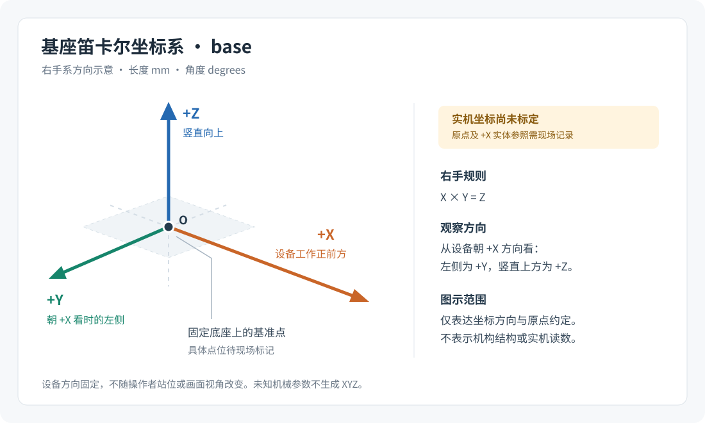

# 笛卡尔坐标约定与待标定参数

本次建立坐标名称、方向、单位和离线换算基础。**实机坐标尚未标定，当前 App 不显示由四轴计数计算的末端 XYZ，也不提供笛卡尔运动。** 本文中的数学定义不能替代机械参数、原点标记、现场测量或动作验收。

当前已知软件轴2是丝杆升降轴，正向上升、反向下降；轴1、3、4的实体对应、机械结构和各轴零位仍未知。轴2的 `262144 count/电机圈` 是现有程序核对的历史预期，不能推广到其他轴，亦不能单凭它算出升降毫米数。机械参数的现有边界见[交接说明](HANDOFF.md#1-版本与配置)。

## 1. 基座坐标系 base

采用右手笛卡尔坐标系，`X × Y = Z`：

| 项目 | 本项目约定 | 现场状态 |
| --- | --- | --- |
| 原点 O | 固定底座上可重复标记的基准点 | 具体点位与标记方法待确定 |
| +X | 设备约定的工作正前方 | 对应哪条实体边、刻线或目标点待标记 |
| +Y | 从设备朝 +X 方向看时的左侧 | 随 +X 与 +Z 按右手规则确定 |
| +Z | 竖直向上 | 待现场确认与安装基准的关系 |

“工作正前方”指设备自身的约定，不能随操作者站位、相机朝向或窗口视角改变。标定记录应能让另一位操作者重新找到同一个 O 与 +X 参照。选定 O 不等于把四个编码器清零，也不代表执行过回原点。



方向约定参考 ROS 官方 [REP-103](https://raw.githubusercontent.com/ros-infrastructure/rep/master/rep-0103.rst) 的右手系和 X 向前、Y 向左、Z 向上。**本项目仅借用方向约定：长度使用毫米 `mm`，角度使用度 `degrees`；ROS REP-103 使用米和弧度。** 后续接入 ROS 时必须显式换算 `m = mm / 1000`、`rad = degrees × π / 180`，不能把本项目数据直接当作 ROS 的 SI 数值。

## 2. 点、方向、工具与工作坐标系

`CartesianPointMm` 表示某个明确坐标系内的点，三个分量单位均为毫米。`CartesianDirection` 表示方向，不带长度单位；构造坐标变换时，三根轴必须是单位长度、两两正交并组成右手系。仅有三个数还不能确定它们属于哪个坐标系，调用处必须保留 frame 名称。

| 名称 | 含义 | 计算前需要的记录 |
| --- | --- | --- |
| `base` | 固定在底座上的基座坐标系 | O、+X 的实体标记与安装方向 |
| `work` | 固定在工件或工作台上的工作坐标系 | `work` 原点在 `base` 中的位置、三根轴在 `base` 中的方向 |
| `tool` | 固定在末端工具上的工具坐标系 | 与安装基准之间的平移偏置、姿态和安装状态 |
| TCP | 实际关心的工具中心点，例如夹具中心 | TCP 相对工具安装基准的偏置，以及所采用的 `tool` 原点定义 |

如选择 TCP 为 `tool` 原点，仍须记录安装基准到 TCP 的位置和工具轴方向。只测出一个点的位置不能确定工具姿态。`work` 与 `tool` 的偏置和姿态目前均待测，不能默认为零或与 `base` 重合。

## 3. 坐标变换的方向与组合

离线模块使用以下明确约定：

```text
p_to = R × p_from + t
```

这里 `fromFrame` 是输入点所属的源坐标系，`toFrame` 是输出点所属的目标坐标系。`t` 是源坐标系原点在目标坐标系中的位置，单位为毫米。`R` 的三列分别是源坐标系的 +X、+Y、+Z 轴在目标坐标系中表达的单位方向：

```text
    [ xAxis.X  yAxis.X  zAxis.X ]
R = [ xAxis.Y  yAxis.Y  zAxis.Y ]
    [ xAxis.Z  yAxis.Z  zAxis.Z ]
```

不要把这些方向作为矩阵的行，也不要把目标原点在源坐标系中的位置直接放入 `t`。逆变换为 `p_from = Rᵀ × (p_to − t)`，它要求 `R` 为正交的右手旋转矩阵。

| 接口 | 约定 |
| --- | --- |
| `CartesianTransform.FromAxes(fromFrame, toFrame, origin, xAxis, yAxis, zAxis)` | `origin`、三根方向轴都在 `toFrame` 中表达 |
| `FromYawDegrees(fromFrame, toFrame, origin, degrees)` | 按上述方向构造绕目标系 +Z 的偏航；角度单位为度；从 +Z 朝原点看，正角为逆时针 |
| `TransformPoint(point)` | 将 `fromFrame` 中的点换算为 `toFrame` 中的点 |
| `InverseTransformPoint(point)` | 将 `toFrame` 中的点换回 `fromFrame` |
| `Inverse()` | 返回交换源、目标名称的逆变换 |
| `Then(next)` | 先执行当前变换，再执行 `next`：`next(this(point))` |

组合时必须检查名称：`this.ToFrame` 必须等于 `next.FromFrame`。例如 `work → base` 可以接 `base → cell`，得到 `work → cell`；不能直接接 `tool → base`。名称相同只是组合的必要条件，调用者仍须确保两份数据来自同一次有效的标定。

以下数值全部为**合成数学示例**，不代表该机械臂的尺寸、安装位置或标定结果：

```csharp
// 假设 work 原点在 base 中为 (100, 200, 0) mm，绕 +Z 偏航 +90°。
CartesianTransform workToBase = CartesianTransform.FromYawDegrees(
    "work", "base", new CartesianPointMm(100, 200, 0), 90);

CartesianPointMm pointInWork = new CartesianPointMm(10, 0, 0);
CartesianPointMm pointInBase = workToBase.TransformPoint(pointInWork);
// 合成结果：(100, 210, 0) mm。

CartesianPointMm restored = workToBase.InverseTransformPoint(pointInBase);
// 合成结果：(10, 0, 0) mm；实际比较应允许浮点舍入误差。

CartesianTransform baseToCell = CartesianTransform.FromYawDegrees(
    "base", "cell", new CartesianPointMm(1000, 0, 0), 0);
CartesianTransform workToCell = workToBase.Then(baseToCell);
// pointInWork 经 workToCell 后为 (1100, 210, 0) mm。
```

## 4. 编码器计数只能先换算到关节坐标

计数与关节坐标之间的比例必须逐轴记录。为消除“传动比 1:几”的歧义，接口直接使用“一个输出转对应多少个电机转”：

| 参数 | 定义 |
| --- | --- |
| `countsPerMotorRevolution` | 一个电机转对应的有效反馈计数，须与控制卡和驱动比例一致 |
| `motorRevolutionsPerJointRevolution` | 旋转关节转一圈所需的电机圈数 |
| `motorRevolutionsPerScrewRevolution` | 丝杆转一圈所需的电机圈数 |
| `leadMmPerScrewRevolution` | 丝杆转一圈的直线位移，单位毫米 |
| `referenceEncoderCount` | 已测参考关节位置对应的编码器计数 |
| `positiveDirection` | 编码器计数增加与该关节正方向一致时为 `+1`，相反为 `-1` |
| `referenceDegrees` / `referenceMm` | 参考计数对应的关节角度或位移，不是未经测量的默认零位 |

计数差 `Δc = encoder − referenceEncoderCount` 应先扩展为足够宽的数值再相减。离线换算定义为：

```text
旋转关节位置（degrees）
  = referenceDegrees
    + positiveDirection × Δc / countsPerMotorRevolution
      / motorRevolutionsPerJointRevolution × 360

直线关节位置（mm）
  = referenceMm
    + positiveDirection × Δc / countsPerMotorRevolution
      / motorRevolutionsPerScrewRevolution × leadMmPerScrewRevolution
```

接口分别为 `JointCalibration.Rotary(...)` 与 `JointCalibration.Linear(...)`。比例与导程必须大于零，参考位置必须为有限数值，方向只能为 `+1` 或 `-1`。`JointCalibration.TryConvertEncoder(calibration, encoder, out double? position, out string reason)` 遇到缺失标定时返回失败、空位置及原因，不能返回数值零充当未知位置。

轴2已知的“正向上升”是现有现场反馈；导程与机械传动仍未知，因此本次不产生轴2毫米位置。旋转关节的角度、直线关节的位移即使能够独立换算，也仍不是末端 XYZ。获得 TCP 在 `base` 中的位置还需真实机械拓扑、旋转轴线或连杆参数、逐轴参考位与工具偏置，再建立并验证正运动学。本次不假定 SCARA 或其他机型，不实现 FK/IK。

## 5. 待标定记录与失效规则

[cartesian.pending.json](calibration/cartesian.pending.json) 是待现场填写的记录模板，**不是 App 自动加载的配置**。其中 `null` 表示未知；空项不能按零、1:1、某个常见臂长或示例数值补齐。历史预期与实际标定字段分开记录，轴2的历史常数不使标定自动完成。

后续准备接入实机坐标时，至少需要：

1. 标记并记录 `base` 的 O 与 +X 实体参照，确定 `work`、`tool` 及 TCP 的定义。
2. 补齐软件轴到实体关节的对应、关节类型、轴线/连接结构、逐轴比例、方向、参考计数和参考位置。
3. 测量机械尺寸、传动、工具安装偏置和有效范围；保留测量方法、日期、设备参数版本及证据。
4. 在所选机械模型上核对独立测量点，明确模型误差与适用范围；真实动作另外按现场授权和安全条件验收。

本次新增的离线坐标模块不读取控制器、不重置编码器、不设驱动原点、不改变伺服参数或安全逻辑。未来显示实机坐标时，参数不完整、frame 不匹配、反馈读取失败、不完整或过期都应显示 `—` 及原因，并撤销旧位置的有效性。使用同一帧的编码器反馈和采样时间，不把规划计数、缓存值或控制器的插补通道计数直接当作 TCP 实测位置。

如需把“当前点”设为软件参考点，只保存明确的本地参考偏置；该动作不等于机械回零，也不能调用控制器清零来代替标定。编码器换算得到的结果应称为“依据编码器与标定模型估算的坐标”。传动松脱等情况下，电机计数变化可能不对应末端移动。
